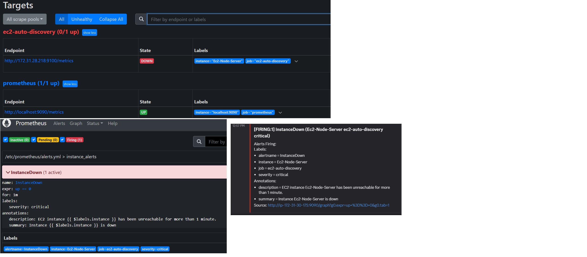
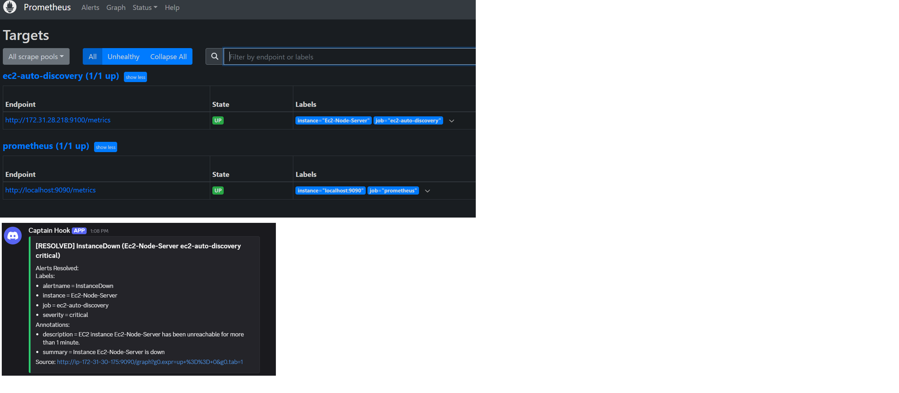

# AWS EC2 Uptime Monitoring System

An automated uptime monitoring solution deployed on AWS EC2 using Prometheus, Node Exporter, Alertmanager, and Discord webhooks.

---

## Repository Structure

The configuration and service files included in this repository should be placed in the following server paths:

| File Name | Target Path on Server | Description |
| :--- | :--- | :--- |
| `prometheus.yml` | `/etc/prometheus/prometheus.yml` | Main Prometheus config with EC2 Auto Discovery |
| `alerts.yml` | `/etc/prometheus/alerts.yml` | PromQL uptime alert rule definitions (`up == 0`) |
| `alertmanager.yml` | `/etc/alertmanager/alertmanager.yml` | Alertmanager route and Discord webhook config |
| `prometheus.service` | `/etc/systemd/system/prometheus.service` | Systemd service unit for Prometheus |
| `alertmanager.service` | `/etc/systemd/system/alertmanager.service` | Systemd service unit for Alertmanager |
| `node_exporter.service` | `/etc/systemd/system/node_exporter.service` | Systemd service unit for Node Exporter |

---

## Setup Guide

### Step 1: Deploy Node Exporter on Target Server
1. Download and extract Node Exporter binary on the target EC2 instance:
   ```bash
   wget https://github.com/prometheus/node_exporter/releases/download/v1.8.2/node_exporter-1.8.2.linux-amd64.tar.gz
   tar xvfz node_exporter-1.8.2.linux-amd64.tar.gz
   sudo mv node_exporter-1.8.2.linux-amd64/node_exporter /usr/local/bin/
   ```
2. Copy `node_exporter.service` from this repository to `/etc/systemd/system/node_exporter.service`.
3. Enable and start the service:
   ```bash
   sudo systemctl daemon-reload
   sudo systemctl enable --now node_exporter
   ```

### Step 2: Configure AWS IAM Role
Attach an IAM Role containing the `AmazonEC2ReadOnlyAccess` policy to the Prometheus EC2 instance to enable EC2 Auto Discovery (`ec2_sd_configs`). Tag target instances with `Monitoring: true`.

### Step 3: Deploy Prometheus and Alertmanager on Monitoring Server
1. Download and install Prometheus and Alertmanager binaries to `/usr/local/bin/`.
2. Copy the configuration files from this repository to their target paths:
   - `prometheus.yml` -> `/etc/prometheus/prometheus.yml`
   - `alerts.yml` -> `/etc/prometheus/alerts.yml`
   - `alertmanager.yml` -> `/etc/alertmanager/alertmanager.yml`
3. Copy `prometheus.service` and `alertmanager.service` to `/etc/systemd/system/`.
4. Enable and start both services:
   ```bash
   sudo systemctl daemon-reload
   sudo systemctl enable --now prometheus
   sudo systemctl enable --now alertmanager
   ```

---

## Proof of Functionality

### 1. Downtime Alert (FIRING)
Stopping the Node Exporter service (`sudo systemctl stop node_exporter`) on the target server causes the target status to drop (`up == 0`). Prometheus triggers the `InstanceDown` alert and forwards it to Discord:



### 2. Recovery Notification (RESOLVED)
Restarting the Node Exporter service (`sudo systemctl start node_exporter`) restores target health (`UP`). Prometheus marks the alert as resolved and sends a `RESOLVED` notification to Discord:



---

## Customizing and Extending Uptime Alert Rules

Uptime alert rules are defined in `/etc/prometheus/alerts.yml`.

### 1. Modifying Evaluation Duration
By default, an alert fires if an instance is down for 1 minute (`for: 1m`). To prevent alerts caused by temporary network blips, increase the evaluation window:
```yaml
- alert: InstanceDown
  expr: up == 0
  for: 5m  # Triggers only if target remains down for 5 consecutive minutes
```

### 2. Adjusting Alert Severity and Annotations
You can customize alert metadata for different channels or escalation steps:
```yaml
- alert: InstanceDown
  expr: up == 0
  for: 1m
  labels:
    severity: warning  # Adjusted severity level
  annotations:
    summary: "Host {{ $labels.instance }} is offline"
    description: "Node exporter endpoint on {{ $labels.instance }} failed health checks."
```

### 3. Applying Changes
To apply rule modifications without restarting the Prometheus process:
```bash
promtool check config /etc/prometheus/prometheus.yml
sudo systemctl reload prometheus
```
